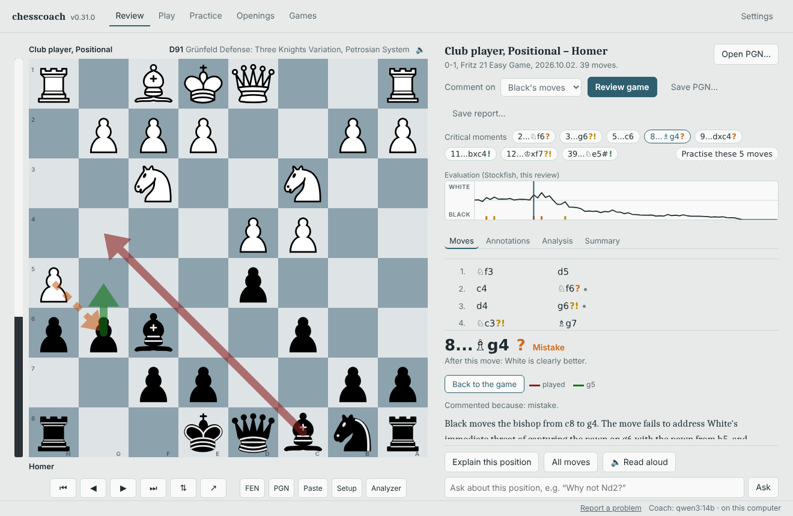
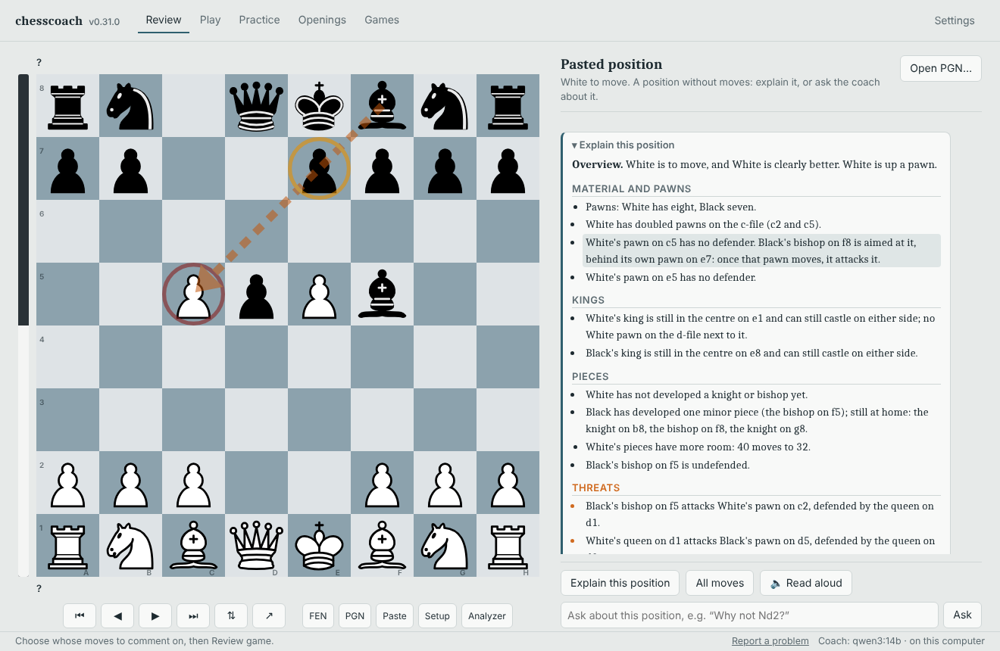

# chesscoach

An offline chess coach that explains your games the way an annotated games
book does: few comments, on the moments that matter, in plain language.
Stockfish finds the moves; a language model only puts the facts into words,
and every fact it states about the pieces is checked on the board first.



## What it does

- **Review a game**: Stockfish analyses every move, the coach comments on
  the critical moments, with move marks (?! ? ??, judged as Lichess judges
  them), accuracy, an evaluation graph, *Show the better move*, how hard each
  error was to see, and a game summary
- **Explain this position**: a coach's sheet written from the board and
  Stockfish (material and pawns, kings, pieces, threats, candidate moves,
  moves to avoid), drawn on the board; the model adds only the plans
- **Ask the coach** ("Why not Nd2?"), and **All moves** with a verdict each
- **Play** against Maia at your rating, with hints a step at a time and a
  blunder alert; **Practice** your own mistakes as exercises
- **Openings** explorer, **Set up a position**, **Import** from Lichess and
  Chess.com, **Read aloud**, annotated PGN export
- Runs on your computer with Ollama, or with an online model and your own
  key (Google Gemini has a free one), checked on the board the same way



## Install on Windows

1. Download `chesscoach-setup-<version>.exe` from
   [Releases](https://github.com/amryounis/chesscoach/releases) and run it.
   Windows may warn that the installer isn't signed: **More info** →
   **Run anyway**. It installs for your user only and brings Stockfish.
2. On first start, a short setup asks who writes the coach's words:
   - **Ollama** on your computer (nothing leaves it): install it from
     [ollama.com](https://ollama.com/download), then press *Download the
     model* in the setup (qwen3:14b, about 9 GB, for a 12 GB graphics card), or
   - **an online model**: a free Google Gemini key from
     [aistudio.google.com/apikey](https://aistudio.google.com/apikey).
     (A ChatGPT subscription is not an OpenAI API key.)

Maia (human-like play) isn't in the installer; everything else works
without it. Found a problem? Use **Report a problem** at the bottom right
of the window.

## From source (any system)

```
git clone https://github.com/amryounis/chesscoach
cd chesscoach
pip install -e ".[gui,advanced]"
chesscoach gui
```

You need Python 3.10+, [Stockfish](https://stockfishchess.org/download/),
and Ollama with a model (`ollama pull qwen3:14b`) or an online key.

## Why it can be trusted

Small language models can't calculate chess and invent pieces and pins. So
chesscoach never asks them to: Stockfish and code work out the facts (what a
move captured, what it left undefended, what each side threatens), code
writes the verdict, and the model only phrases it. Each sentence is then
checked on the board; a false one is rewritten once or removed. Opinions
such as "a strong attack" can't be checked, and the app says so.

## More

- [The full guide](docs/guide.md): every feature, the online model and its
  privacy, the opening study, the command line, the answer keys
- [Development](docs/development.md): tests, the installer build, the code
  layout

GPL-3.0-or-later. Uses python-chess and chessground (Lichess's board), both GPL-3.0.
