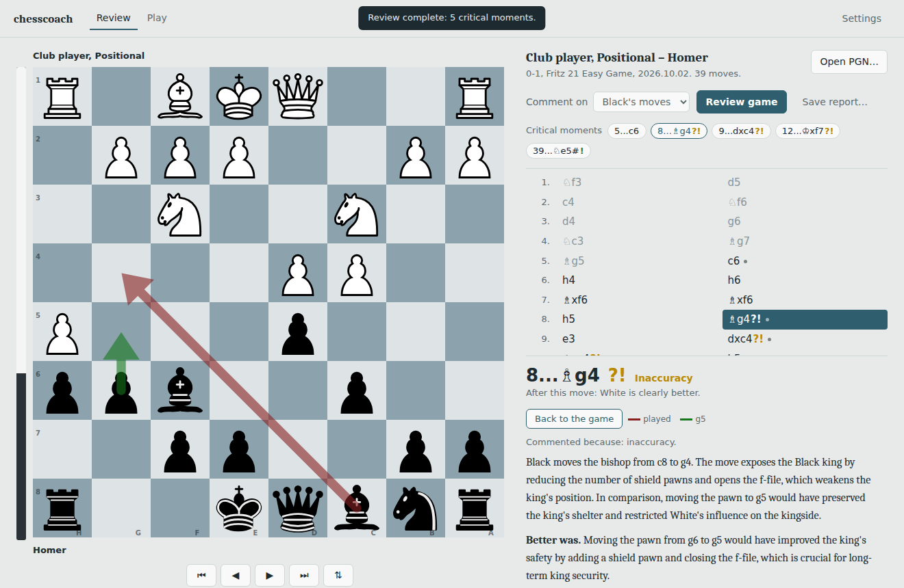

# chesscoach

An offline chess coach that explains your games the way an annotated games
book does: few comments, on the moments that matter, in plain language.

Everything runs on your own machine. No internet, no accounts.



A comment from a real review (qwen3:14b, Homer vs Fritz), unedited:

```
### 11...bxc4 — Excellent (punished the opponent's mistake)
What happened: Black captures White's bishop on c4 with the pawn from b5.
This move exploits White's previous mistake by capturing the bishop on c4,
which was already under attack and left undefended. It removes a key White
piece and strengthens Black's position by creating a clear threat against
the White pawn on g6, which is now hanging and vulnerable.
What now: White will likely capture Black's pawn on f7 with the pawn from
g6, giving check. Black should respond by moving the king to f8, which is
the only safe square, and then prepare to defend against White's queen
moving to c2.
```

(Earlier versions of this README showed 8...Bg4 "opens the f-file". The
f-file opens two moves later, after 9.hxg6 fxg6, and the checker let it
through. It now checks what a sentence says the move itself did on the
position right after the move.)

## The idea: the language model only narrates

Small local language models cannot calculate chess, and they cannot read
FEN. Asked to analyse a position, they invent pieces, pins and variations.
So chesscoach never asks them to. Each part does only what it is good at:

| Part | Job |
|---|---|
| **Stockfish** | Evaluates positions and finds the best moves |
| **Maia 3** | Predicts what a human would play, to tell hard moves from natural ones |
| **python-chess** | Turns positions into verified facts: what a move captured, which pieces it stopped defending, how the position two moves later differs from the engine's line |
| **Stockfish, again** | Verifies the concepts behind a moment: what each side really threatens, what a piece was holding together, which facts matter most |
| **Local LLM** (Ollama) | Rewrites those facts as a coach's comment, and nothing else |

The move labels (Excellent … Blunder), who played the move, the size of the
advantage and the first sentence of each comment are all computed in code.

What the model writes is then checked against the board, as far as code
can read it: a piece it places on a square, an attack or defence between
named pieces, a pin, a fork and which pieces it hits, a king's pawn
shelter, a file opened, material, and legal-move counts. A claim passes
if it holds before or after the move or along the engine's line, so a
consequence two moves later counts ("8...Bg4 ... opens the f-file" passes
because of 9.hxg6 fxg6). A false claim goes back to the model with the
correction for one rewrite; if it is still false, the sentence is removed.

**What is not checked:** judgements code cannot parse, such as "a strong
attack", "the initiative", "a weak square" or "passive", and any sentence
whose wording the checker does not recognise. Those are the model's
words. The coach says less rather than something false about the pieces;
its strategic opinions still need a reader's eye. The app says this under
every comment.

## Requirements

- Python 3.10+
- [Stockfish](https://stockfishchess.org/download/)
- [Ollama](https://ollama.com) with a model pulled, e.g. `ollama pull qwen3:14b`
  (fits a 12 GB GPU; smaller 7–8B models invent noticeably more)
- Optional: [Maia 3](https://github.com/CSSLab/maia3) for human-move prediction
- Optional: a Polyglot opening book (`.bin`), so opening theory is skipped

## Install

```
git clone https://github.com/amryounis/chesscoach
cd chesscoach
pip install -e ".[gui]"      # or just  pip install -e .  for the command line only
```

## Configure

```
chesscoach config --init     # writes a commented config file
chesscoach config            # shows the settings in effect
```

Set at least `stockfish_path`. Settings can also come from environment
variables (`CHESSCOACH_STOCKFISH_PATH`, `CHESSCOACH_MODEL`, …) or flags
(`--stockfish`, `--book`, `--model`, `--depth`).

## Use the desktop app

```
chesscoach gui
```

(or the `chesscoach-app` shortcut, which opens without a console window)

- **Review**: open a PGN, choose whose moves to comment on, and review.
  Stockfish analyses every position, then the coach writes about the critical
  moments. Moves carry the usual marks (?! inaccuracy, ? mistake,
  ?? blunder, ! a strong find); on a mistake, *Show the better move* puts the
  position before it on the board with your move in red and the engine's in
  green. Arrow keys step through the game.
- **Play**: a training game against Maia at the rating you choose. Maia plays
  like a human of that strength, mistakes included. When the game ends,
  *Review this game* sends it straight to the coach. Without Maia the
  opponent is Stockfish, which can't play below 1320 and plays like an
  engine; the setup screen says so, with its real strength, before you start.
  *Hint* helps a step at a time: first what is going on ("Black threatens
  checkmate with Qxf7#", "something is left unprotected", "nothing urgent:
  bring a piece into the game"), then the square, then the piece, and last
  the move with the engine's line; often the first step is enough. The
  **blunder alert** asks "Are you sure about Qxh7? It looks like a blunder"
  before a move that throws away a lot of winning chance, without saying
  why (Settings: before blunders, before mistakes too, before inaccuracies
  too, or off). Hints and alerts are kept in the game's PGN, and the review
  says how much help was taken.
- **Practice**: your inaccuracies, mistakes and blunders from reviewed games
  come back as positions to solve. Make a move; Stockfish judges it (another
  move that keeps your chances counts), then you see the engine's move, its
  line and what the coach said in the review. Exercises you miss come back
  first. Choose the game you just reviewed or all your reviewed games.
  *Hint* works here too; an exercise solved after being shown the square or
  the piece counts as solved with hints and comes back to do alone.
- **The opening** the game is in is named above the board at every move,
  in Review and in Play, by position, so transpositions are named right;
  the speaker button beside it says each new name aloud.
- **Copy and paste**: under the board, *FEN* and *PGN* copy the position and
  the game (after a review, with the coach's notes); *Paste* or Ctrl+V
  opens a PGN or a FEN from the clipboard. A pasted position opens in Review,
  where Explain this position and Ask the coach work on it.
- **All moves**: beside Explain this position, and in Practice after an
  answer: every legal move with a short verdict from the engine ("Best
  move: recaptures", "Blunder: loses a knight (after 5...exd5)", "Allows
  mate in 1"), so "why not my move?" has an answer. Hover a move to see it.
- **Explain this position / Ask the coach**: under the comment, for any move
  of the open game. The coach explains the position, or answers a question
  such as "Why not Nd2?", "Is my bishop safe?" or "After Re1+ Kd8 Ne5,
  does the knight fork anything?". It cannot see the board: code works out
  what the question needs, gathers verified facts and writes the verdict
  (which move is better, whether a piece is attacked); the model explains,
  and its answer is checked against the board before you see it.
- **How hard was it?** Under each commented error: *in plain sight* (a
  two-move look already shows the better move), *partly hidden* or *hard to
  see* (it only proves itself several moves deep), measured with Stockfish
  at two depths, plus what Maia says players at your rating play there.
  Forced lines (only legal replies, or check after check) are pointed out.
- **Game summary**: at the top of a finished review, written by code from
  the stored facts of each move: your errors, the biggest swing, the themes
  that recur ("three of your errors weakened your king's pawn shelter"),
  and below it the patterns across your reviewed games
  (`chesscoach patterns` on the command line). Every line can show the
  facts it rests on.
- **Games**: every game you play or review is kept as ordinary PGN files
  (Played.pgn, Reviewed.pgn, and any file you add), searchable by player,
  event or opening and sortable by column; a reviewed game opens with its
  review. The **opening explorer** shows what was played in each position
  of your games and how it scored, for you as White or as Black.
- **Save PGN…** after a review: the game with ?!/?/?? marks, [%eval] on
  every move, the coach's comments and the engine's better line as a
  variation on every error, for ChessBase, Lichess, Lucas Chess or SCID.
  Each side's accuracy (Lichess's method) and the tactical motifs each error
  allowed or missed (fork, pin, skewer…) are in the review and the PGN.
- **Settings**: engine paths, model, your name and rating, the games
  folder, saved to the user config file.

The board is [chessground](https://github.com/lichess-org/chessground)
(Lichess's board), bundled so the app works offline.

## Study an opening book (once, overnight)

Coaches tell young players not to memorise opening lines but to understand
the ideas behind them. `chesscoach book study` walks a Polyglot opening
book (the one in Settings, or a file you give) and has the coach explain the
idea of every popular move: what it develops, which central squares it
takes, what it prepares, how it fits the opening's typical plan and the
book's main answers. Every comment is built from facts code works out and
goes through the board check. The opening explorer (Games tab) then shows,
in each position, the book's moves with how often they are played,
Stockfish's verdict, the idea of each move (hover it), and your own record
with it.

```
chesscoach book study --dry-run         # how many moves, and roughly how long
chesscoach book study                   # run it; Ctrl+C to stop, run again to go on
chesscoach book show "e4 e5 Nf3"        # what the study says about a position
```

A full book has far more positions than a local model can comment on, so
the study follows only the lines that are played: a move the book gives at
least 5% of a position (`--min-share`), a line while it stays above 0.2% of
games (`--min-line`), up to 20 half-moves (`--plies`), each position once.
With a typical book that is about 500 positions and 750 moves, a few hours
with qwen3:14b on a 12 GB GPU. Raise or lower the limits to taste; what is
written is kept.

## Use from the command line

```
chesscoach review mygame.pgn --side black
```

This writes `mygame_annotated.md`: every move with its label, then comments
on the critical moments only:

- the first move out of the opening book
- inaccuracies, mistakes and blunders, with what the better move kept
- the only good move, when you found it and it wasn't obvious
- punishing your opponent's mistake
- checkmate

Any position, without a game file:

```
chesscoach explain --moves "1. e4 e5 2. Nf3 Nc6 3. Bc4 Nd4"
chesscoach ask "Can White take the pawn on e5?" --moves "1. e4 e5 2. Nf3 Nc6 3. Bc4 Nd4" --show-tools
```

Other options: `--every-move` to comment on every non-book move,
`--model A --model B` to compare models on the same prompts,
`--verbose` to print every prompt. `chesscoach demo` runs two fixed test
positions, which is a quick way to try a new model.

## Measure it: answer keys

```
chesscoach eval                                  # facts layer only, no model
chesscoach eval -m qwen3:14b --mode pipeline --mode raw --report eval.md
chesscoach eval --key rook-check --text reply.txt  # score any pasted reply
```

Each answer key is a position whose correct explanation is known: the
facts it must mention, and the false claims models have actually made
("material is equal", "the knight forks the rook on b7"). `eval` reports
how many required facts the facts layer supplies, how many the model's
text states, and every false claim or invented piece. `pipeline` scores
our annotation; `raw` scores the model given only the FEN and Stockfish's
lines, which is the comparison that shows what the facts layer is worth.
Keys live in `src/chesscoach/answer_keys/`; add your own with `--keys`.

## Development

```
pip install -e ".[dev]"
pytest              # engine tests are skipped if Stockfish isn't found
ruff check src tests
```

Package layout (`src/chesscoach/`):

| Module | Responsibility |
|---|---|
| `config` | settings from defaults, config file, environment, flags |
| `engine` | Stockfish analysis, Maia prediction |
| `assessment` | win probability, move labels, verdict wording |
| `describe` | moves, effects and boards in plain English |
| `facts` | Tier 1 facts: named material, castling, undefended pieces, legal moves, following a line |
| `features` / `tactics` | positional and tactical facts; comparing two lines |
| `prompts` / `narrator` | prompt building, LLM calls, output check and retry |
| `grounding` | checks the claims it can parse (pieces, attacks, pins, forks, shelter, files, material) on the board; judgements are not checked |
| `concepts` | engine-verified threats, piece roles, equal moves, ranked key facts |
| `coach` | "Explain this position", and the "Ask the coach" agent with its fact tools |
| `opening` / `moments` | book detection, choosing what to comment on |
| `review` / `report` | whole-game review (structured data) and the markdown report |
| `play` | training games against Maia (or limited Stockfish) |
| `gui` | desktop app: `api.py` (Python side), `static/` (page), `app.py` (window) |
| `evaluate` | answer-key harness (`chesscoach eval`) |
| `accuracy` / `motifs` / `classify` | accuracy %, tactical motifs in engine lines, !! ! !? and the counts |
| `library` | your games: PGN files with an index, saved reviews, the opening explorer |
| `pgn_export` | the reviewed game as an annotated PGN |
| `practice` | your mistakes as exercises |
| `history` / `summary` | patterns across games; the game summary |
| `logfile` | chesscoach.log: errors and review timings |
| `cli` | the `chesscoach` command |

## Roadmap

Done: game review with critical moments, opening-book skipping, labels
from win probability, a facts layer with engine-verified threats and piece
roles, a board check on the claims code can parse, an answer-key
harness, "Explain this position" and "Ask the coach", and the desktop app
with review and play against Maia.

Also done: game summaries, recurring themes across your games, and
practising your own mistakes.

Next: a quicker review mode for modest hardware, a board editor / FEN
import so the coach can explain any position, and an easier first-run
setup.

## License

GPL-3.0-or-later. chesscoach uses python-chess and chessground, both GPL-3.0.
